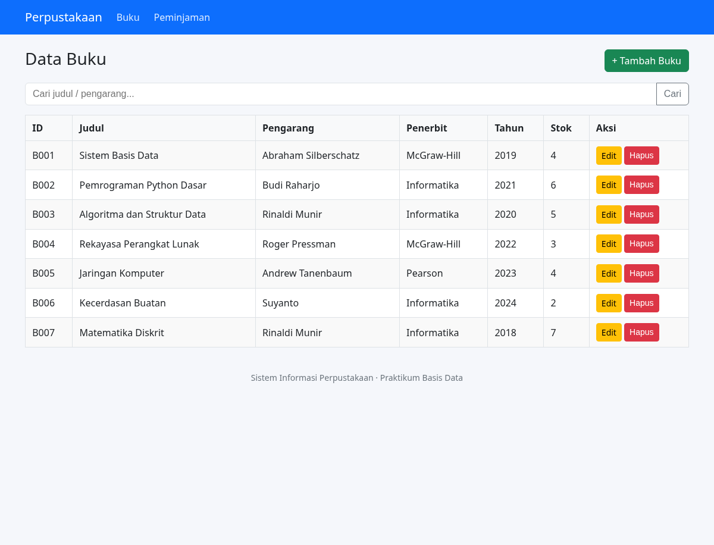
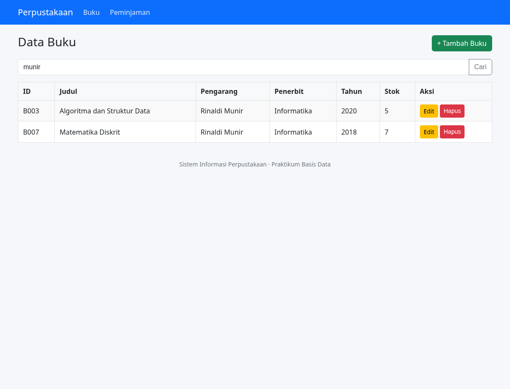
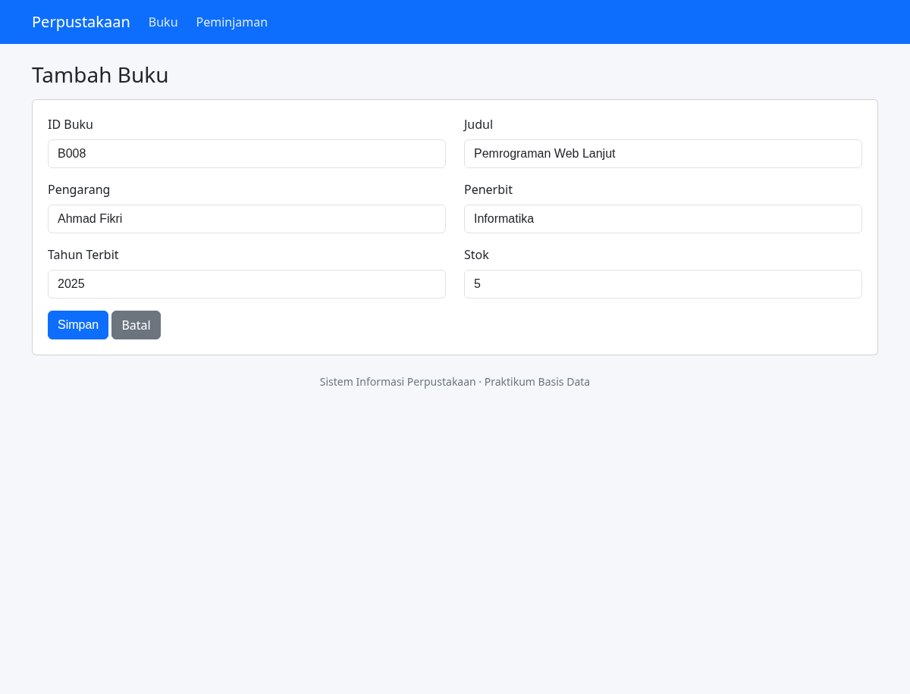
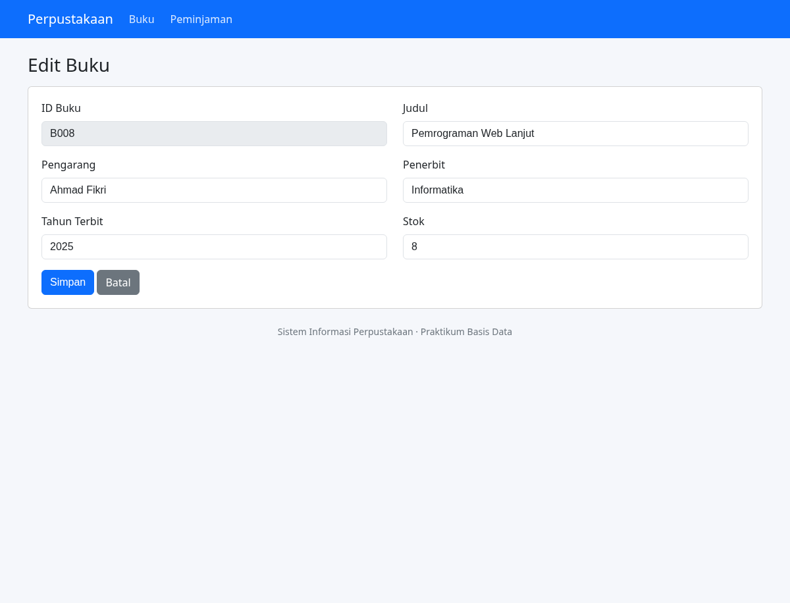
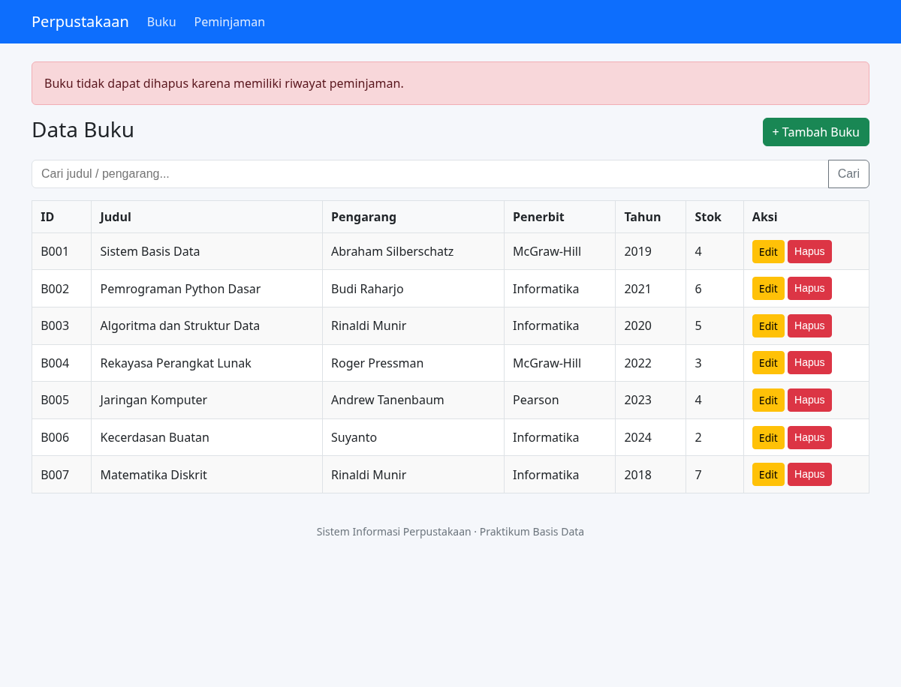
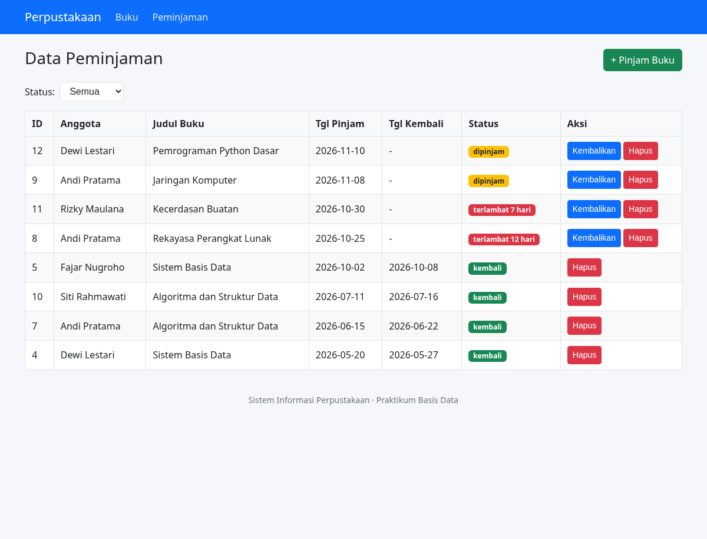
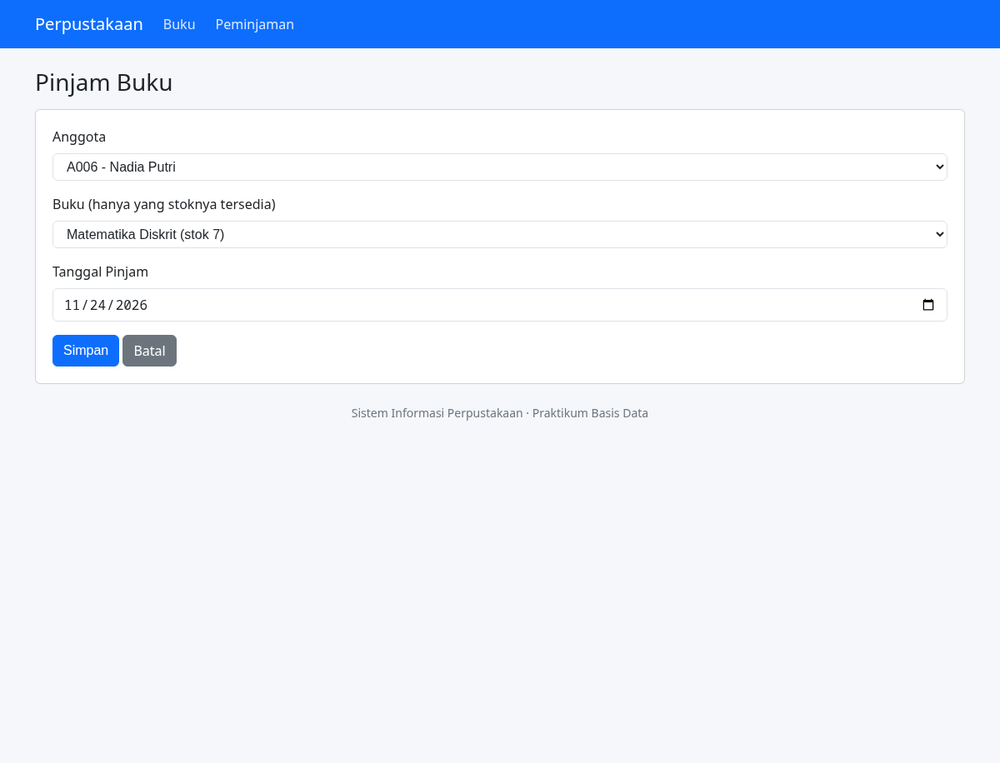
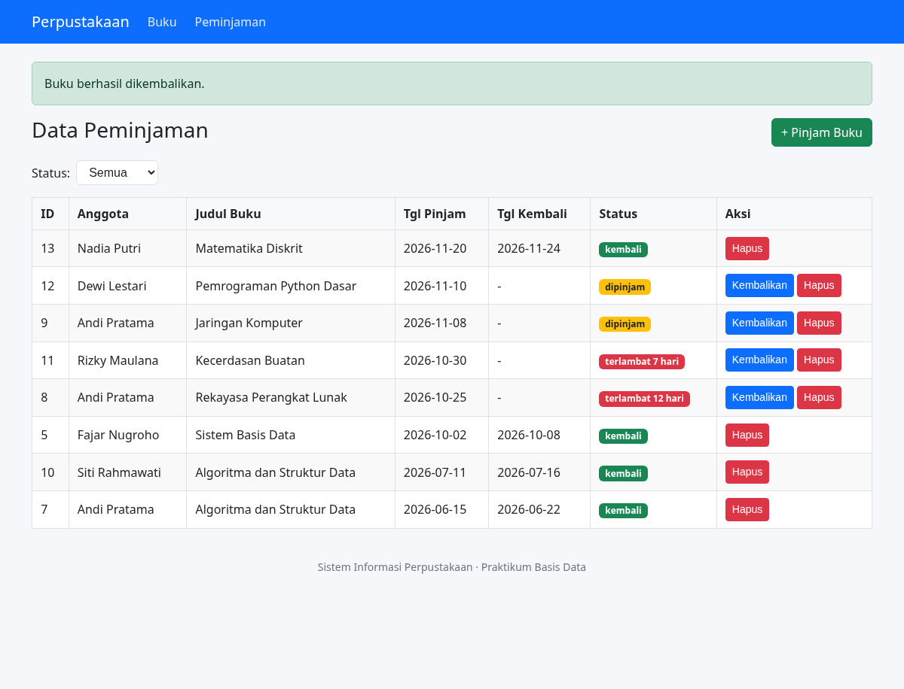

# Sistem Informasi Perpustakaan — CRUD Dasar (Python Flask + MySQL)

Implementasi **Studi Kasus 1: Sistem Informasi Perpustakaan** (Mata Kuliah Basis Data) menggunakan **Python (Flask)**, **PyMySQL**, **Jinja2**, dan **Bootstrap 5**.

## Fitur Utama

1. **Modul Buku (CRUD penuh pada tabel `buku`)**
   - **Read**: Menampilkan daftar buku beserta fitur pencarian berdasarkan judul atau pengarang (`LIKE` dengan *prepared statement*).
   - **Create**: Menambah buku baru dengan validasi dua lapis (format ID `Bxxx`, judul/pengarang wajib diisi, stok `>= 0`) dan penanganan duplikat *primary key* (MySQL error `1062`).
   - **Update**: Mengubah data buku (kolom `id_buku` bersifat `readonly` dan dijaga di sisi server).
   - **Delete**: Menghapus buku via `POST`, dengan perlindungan *foreign key* (menolak penghapusan buku yang sudah memiliki riwayat peminjaman, MySQL error `1451`).
2. **Modul Peminjaman (CRUD berelasi pada tabel `peminjaman`, `anggota`, dan `buku`)**
   - **Read**: Menampilkan transaksi dengan `INNER JOIN`, filter status (`Semua`, `Dipinjam`, `Kembali`), dan perhitungan keterlambatan otomatis (`DATEDIFF(CURDATE(), tgl_pinjam) - 7`).
   - **Create**: Mencatat peminjaman baru dalam **transaksi basis data** (`SELECT ... FOR UPDATE`, `INSERT`, dan `UPDATE buku SET stok = stok - 1`).
   - **Update (Pengembalian)**: Memproses pengembalian buku dalam transaksi (`status = 'kembali'`, `tgl_kembali = CURDATE()`, `stok = stok + 1`).
   - **Delete**: Menghapus transaksi dalam transaksi (jika status masih `dipinjam`, stok otomatis dikembalikan `+1`).

## Struktur Proyek

```text
perpus-flask/
├── app.py                     # Titik masuk: membuat app & mendaftarkan blueprint
├── config.py                  # Konfigurasi (SECRET_KEY, koneksi DB)
├── db.py                      # Membuka/menutup koneksi PyMySQL per request
├── db_perpustakaan.sql        # Skrip pembuatan basis data dan data awal
├── requirements.txt           # Daftar dependensi Python
├── .gitignore                 # Daftar file/folder yang diabaikan Git
├── routes/
│   ├── __init__.py            # Penanda package
│   ├── buku.py                # Route CRUD modul buku
│   └── peminjaman.py          # Route CRUD modul peminjaman
├── static/
│   └── css/
│       └── style.css          # CSS tambahan
├── templates/
│   ├── base.html              # Kerangka halaman + navbar + pesan flash
│   ├── _errors.html           # Komponen daftar error validasi
│   ├── buku/
│   │   ├── index.html         # Halaman daftar buku (Read)
│   │   └── form.html          # Form tambah & edit buku (Create & Update)
│   └── peminjaman/
│       ├── index.html         # Halaman daftar peminjaman (Read JOIN)
│       └── form.html          # Form catat peminjaman (Create)
└── screenshots/               # Tangkapan layar tampilan hasil aplikasi
```

## Prasyarat

- Python 3.10 atau lebih baru
- MySQL / MariaDB (misalnya via XAMPP atau Laragon)

## Cara Menjalankan Aplikasi

1. **Impor Basis Data**
   Jalankan skrip `db_perpustakaan.sql` melalui phpMyAdmin (tab *SQL* / *Import*) atau terminal:
   ```bash
   mysql -u root -p < db_perpustakaan.sql
   ```

2. **Siapkan Virtual Environment & Instal Dependensi**
   ```bash
   python -m venv venv

   # Windows:
   venv\Scripts\activate
   # Linux / macOS:
   source venv/bin/activate

   pip install -r requirements.txt
   ```

3. **Sesuaikan Konfigurasi Koneksi (Opsional)**
   Secara default `config.py` menggunakan host `localhost`, user `root`, password kosong, dan database `db_perpustakaan`. Anda dapat mengubahnya di `config.py` atau melalui variabel lingkungan (`DB_HOST`, `DB_USER`, `DB_PASSWORD`, `DB_NAME`, `SECRET_KEY`).

4. **Jalankan Server Flask**
   ```bash
   flask --app app run --debug
   # atau
   python app.py
   ```
   Buka browser dan akses `http://127.0.0.1:5000`.

## Peta URL Aplikasi

| Metode | URL | Fungsi | Operasi |
| :--- | :--- | :--- | :--- |
| `GET` | `/buku/` | `buku.index` | Read daftar buku & pencarian |
| `GET/POST` | `/buku/tambah` | `buku.tambah` | Create buku |
| `GET/POST` | `/buku/<id_buku>/edit` | `buku.edit` | Update buku |
| `POST` | `/buku/<id_buku>/hapus` | `buku.hapus` | Delete buku |
| `GET` | `/peminjaman/` | `peminjaman.index` | Read transaksi (JOIN) & filter |
| `GET/POST` | `/peminjaman/tambah` | `peminjaman.tambah` | Create transaksi peminjaman |
| `POST` | `/peminjaman/<id>/kembalikan` | `peminjaman.kembalikan` | Update status pengembalian |
| `POST` | `/peminjaman/<id>/hapus` | `peminjaman.hapus` | Delete transaksi |

## Tampilan Hasil

### 1. Halaman Daftar Buku (Read)


### 2. Pencarian Buku (`q=munir`)


### 3. Form Tambah Buku (Create)


### 4. Form Edit Buku (Update — ID Readonly)


### 5. Penolakan Hapus Buku Berelasi (Error 1451 Foreign Key)


### 6. Halaman Daftar Peminjaman (Read dengan JOIN & Penanda Keterlambatan)


### 7. Form Catat Peminjaman Baru (Create Transaksi)


### 8. Pengembalian Buku Berhasil (Update Transaksi)

